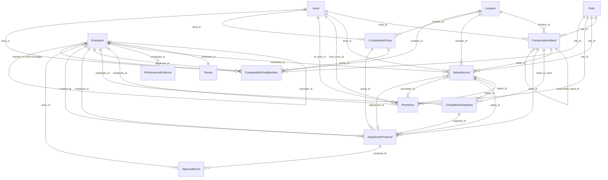

# Entity-Relationship Diagram

Cardinality summary: see the table in `data_dictionary.md`. The only N:M relationship is **Employee ↔ ComparableGroup**, resolved by the bridge table `ComparableGroupMember`.
